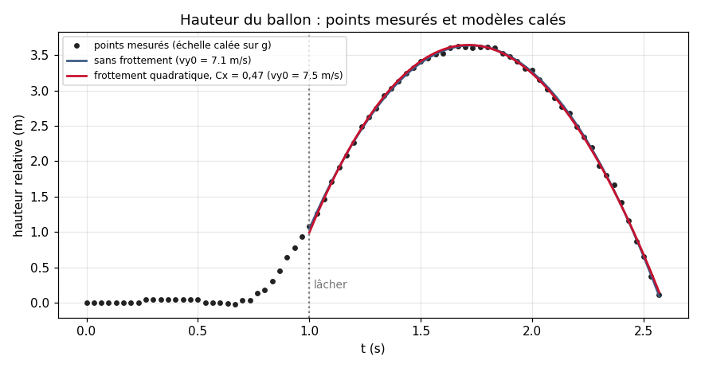
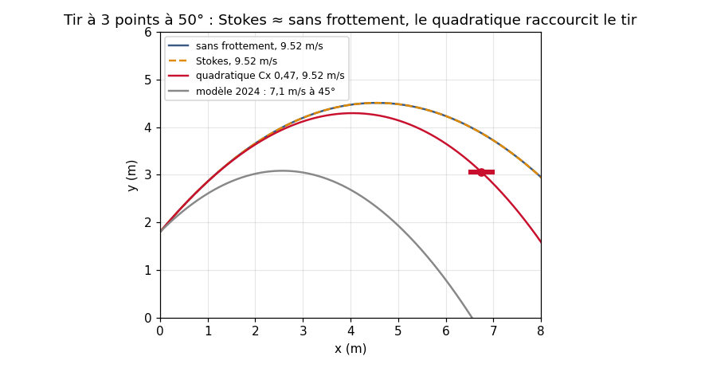

# Trajectoire d'un tir de basket : modèle, mesures et frottement de l'air

🇫🇷 [Français](#français) · 🇬🇧 [English](#english)



---

## Français

### Contexte
Projet de **modélisation physique (CPGE TSI, 2024)**. La question : *peut-on augmenter ses chances de réussir un tir à 3 points en jouant sur la vitesse, l'angle et la hauteur de lâcher ?* J'ai mené le projet en trois étapes :
1. une **étude théorique sans frottement**, avec les équations horaires et la trajectoire parabolique ;
2. une **expérience** : un vrai tir filmé, puis pointé image par image avec **pymecavideo** ;
3. une **étude avec frottement de l'air**, résolue numériquement en Python.

En 2026, j'ai repris ce travail : j'ai remis les points mesurés au propre, et j'ai comparé trois modèles de frottement avec un script de vérification.

### 1. Étude théorique sans frottement
Le principe fondamental de la dynamique appliqué au ballon, soumis à son seul poids, donne `ẍ = 0` et `ÿ = −g`. On en déduit les équations horaires, puis la trajectoire :

> **y(x) = y₀ + x·tan α − g·x² / (2·v₀²·cos² α)**

La résolution numérique (`solve_ivp`, RK45) se trouve dans [`code_2024/trajectoire_sans_frottement.py`](code_2024/trajectoire_sans_frottement.py), avec v₀ = 7,1 m/s, α = 45° et un lâcher à 1,80 m.

### 2. Mesures
J'ai filmé un tir, puis j'ai pointé la position du ballon image par image avec pymecavideo. Les 78 points de hauteur y(t) sont dans [`data/pointage_y_t.csv`](data/pointage_y_t.csv).

**Limites des données.** La vidéo et le fichier de pointage d'origine n'ont pas été conservés : les points viennent de la courbe de pymecavideo, numérisée en 2026. Les graduations verticales étaient illisibles, donc **l'échelle verticale est calée sur g**. **La position horizontale x(t) n'est pas récupérable.** Le détail est dans [`data/LISEZMOI.md`](data/LISEZMOI.md).

### 3. Étude avec frottement de l'air (2024)
J'ai ajouté une force de frottement −k·|v|·**v** et résolu le système en Python : [`code_2024/trajectoire_avec_frottement.py`](code_2024/trajectoire_avec_frottement.py). Ma conclusion de 2024 était que le frottement de l'air restait négligeable, et que la trajectoire, parabolique, se règle par la hauteur, la vitesse et l'angle de lâcher.

---

### Vérification en 2026
Le script [`scripts/comparaison_frottements.py`](scripts/comparaison_frottements.py) compare trois modèles : **sans frottement**, **loi de Stokes** et **frottement quadratique ½ρCₓSv²**. Toutes les valeurs sont dans [`docs/valeurs.md`](docs/valeurs.md).

1. **Le bon modèle de frottement.** La loi de Stokes (F = 6πηr·v) ne vaut que pour un nombre de Reynolds inférieur à 1. Pour un ballon à 8 m/s, **Re ≈ 1,3·10⁵** : la traînée est **quadratique**, F = ½ρCₓSv². Avec Cₓ = 0,47, elle vaut 0,87 N, soit **14 % du poids** au départ du tir. Mon code de 2024 avait déjà la bonne forme (−k·|v|·**v**), mais avec le coefficient de Stokes, k = 4,37·10⁻⁵ kg/s, au lieu de ½ρCₓS ≈ 0,0136 kg/m. Le frottement était donc **environ 300 fois trop faible**. Voilà pourquoi les courbes avec et sans frottement se confondaient, et pourquoi le frottement semblait négligeable.

2. **Ce que disent les points.** Le calage du modèle sur les points mesurés donne une **vitesse verticale au lâcher d'environ 7,1 à 7,5 m/s**, et un sommet environ 2,6 m au-dessus du point de lâcher. Le modèle de 2024 (7,1 m/s à 45°) n'a que 5,0 m/s de vitesse verticale, et ne monte que de 1,3 m au-dessus du lâcher : le vrai tir était nettement plus puissant. Avec 7,1 m/s à 45°, le ballon **retombe au sol avant d'atteindre 6,75 m**. Pour un tir à 3 points, il faut environ **9 m/s sans frottement, et 9,5 m/s avec la traînée quadratique** (à 50°, l'angle qui demande le moins de vitesse).

   

3. **Caler Cₓ sur les points ?** J'ai laissé l'échelle verticale libre, et j'ai recalé les points pour plusieurs valeurs de Cₓ. L'écart quadratique moyen passe de 2,7 cm (sans frottement) à 3,2 cm (Cₓ = 0,47), alors que l'erreur de numérisation est d'environ 3 cm. **Avec la seule hauteur, les points ne permettent donc pas de mesurer Cₓ.** Il faudrait x(t), et une échelle mesurée sur la vidéo, par exemple la hauteur du panier. J'utilise donc la valeur théorique d'une sphère, Cₓ = 0,47, et je montre l'effet d'une erreur : à 50°, passer à Cₓ = 0,6 demande 0,17 m/s de plus.

4. **Ce que ça change pour la question de départ.** Avec la traînée, l'angle qui demande le moins de vitesse reste d'environ **50°**. Autour de cet optimum, la vitesse nécessaire varie peu avec l'angle (moins de 0,15 m/s entre 45° et 55°). Un tir à 3 points est donc plus tolérant sur l'angle que sur la vitesse : c'est le dosage de la vitesse qui compte le plus.

### Contenu du dépôt
```
data/       pointage_y_t.csv (78 points y(t)) + LISEZMOI.md (origine et limites)
code_2024/  mes deux modèles Python de 2024, recopiés et nettoyés
scripts/    comparaison_frottements.py : calage, ordres de grandeur, tir à 3 points (2026)
docs/       valeurs.md : ballon, air, terrain, équations, résultats
images/     graphiques produits par le script
```
Python 3 avec `numpy` et `matplotlib` (et `scipy` pour les modèles de 2024).

---

## English

### Context
**Physics modelling project (CPGE TSI, 2024)**: can you raise your chances of making a 3-point shot by adjusting speed, angle and release height? The project had three steps:
1. a **frictionless theory**: equations of motion and a parabolic trajectory;
2. an **experiment**: a real shot, filmed and tracked frame by frame with pymecavideo;
3. a **study with air drag**, solved numerically in Python.

**Data:** the 78 measured points y(t) are in `data/`. The original video and tracking file were lost, so the points were digitized from the pymecavideo graph. The **vertical scale is fitted to g**, and **x(t) cannot be recovered**.

### 2026 verification
1. **Right drag law.** At Re ≈ 1.3·10⁵, drag is **quadratic**, not Stokes: 0.87 N, or 14 % of the weight. My 2024 code had the right form (−k·|v|·**v**) but used the Stokes constant k = 4.37·10⁻⁵ kg/s instead of ½ρCₓS ≈ 0.0136 kg/m, about **300 times too small**. That is why drag looked negligible.
2. **What the points say.** Vertical release speed is about 7.1 to 7.5 m/s, versus 5.0 m/s in the 2024 model (7.1 m/s at 45°), which falls short of 6.75 m. A 3-pointer needs about 9 m/s without drag and 9.5 m/s with quadratic drag, at 50°.
3. **Fitting Cₓ.** The height-only points cannot pin down Cₓ: the fit error goes from 2.7 to 3.2 cm, while digitization error is about 3 cm. I therefore use the textbook sphere value of 0.47 and show the sensitivity (Cₓ = 0.6 adds 0.17 m/s).
4. **Answer to the question.** The minimum-speed angle stays near 50°, and the required speed barely changes between 45° and 55°. Speed control matters more than angle.
